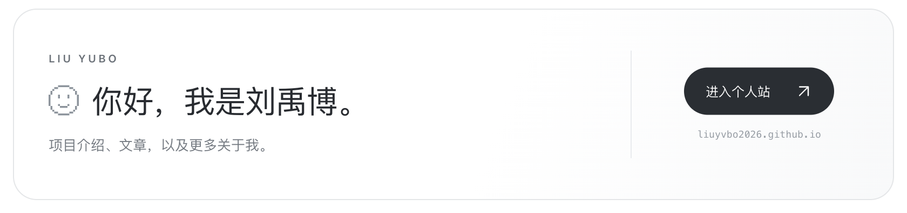
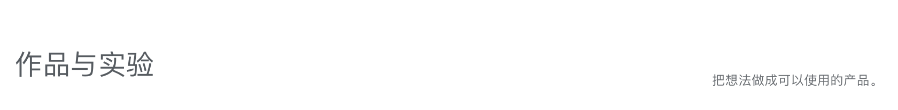
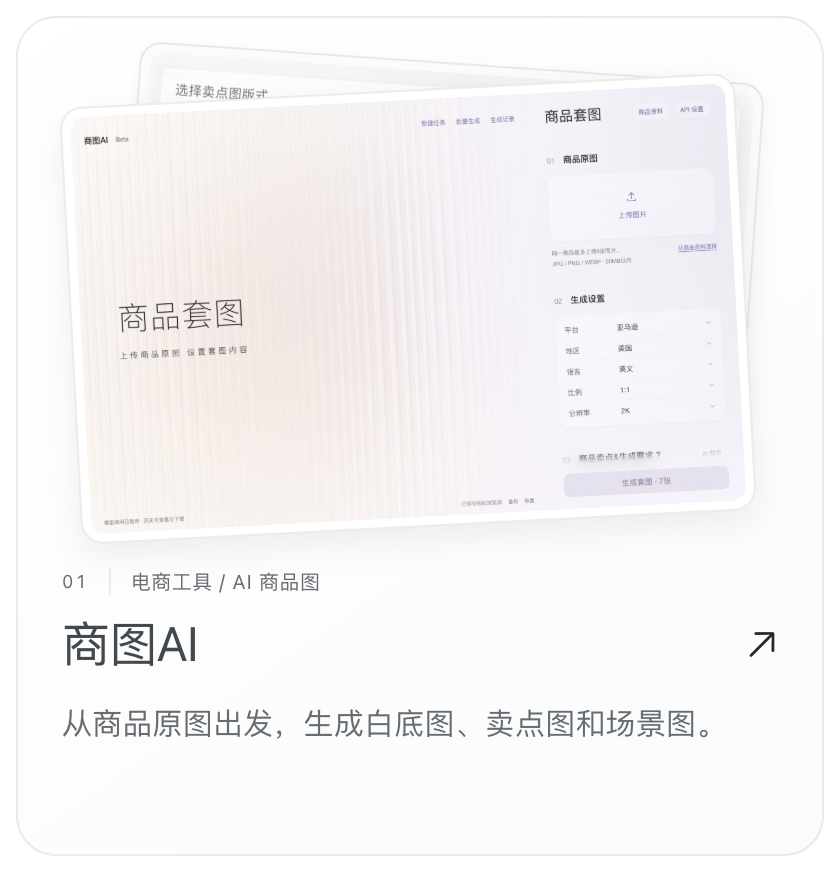
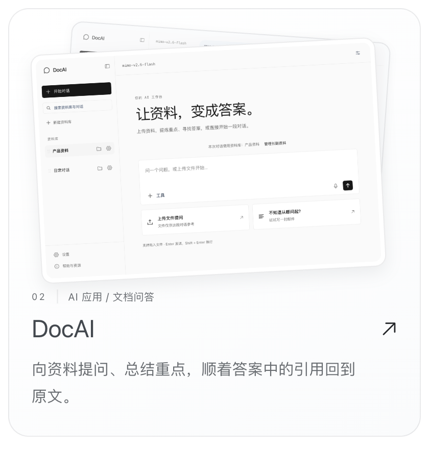
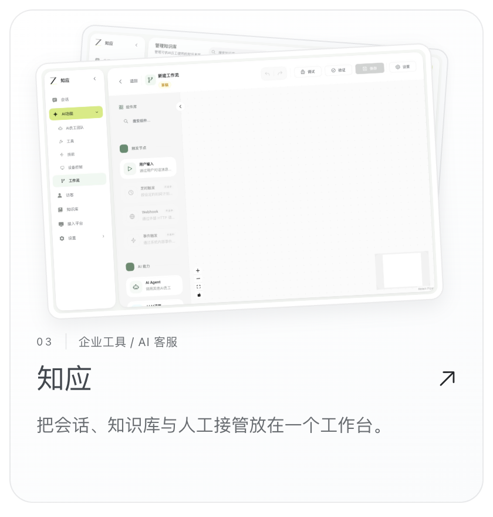
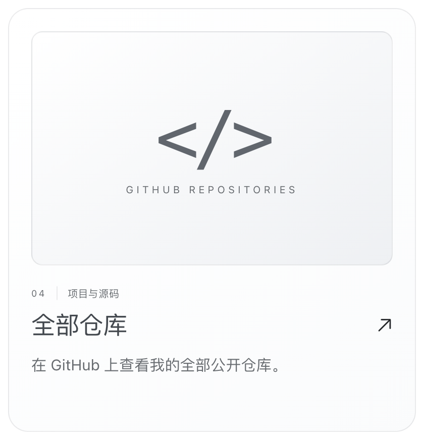

<!-- Profile visuals: design/site-entry/hero.html; design/glass-works/render.html -->

  <a href="https://liuyvbo2026.github.io/">
    <picture>
      <source media="(max-width: 1011px) and (prefers-color-scheme: dark)" srcset="assets/site-entry/hero-greeting-soft-mobile-dark.webp">
      <source media="(max-width: 1011px)" srcset="assets/site-entry/hero-greeting-soft-mobile-light.webp">
      <source media="(prefers-color-scheme: dark)" srcset="assets/site-entry/hero-greeting-soft-desktop-dark.webp">
      
    </picture>
  </a>

  <picture>
      <source media="(max-width: 1011px) and (prefers-color-scheme: dark)" srcset="assets/flat-works/heading-soft-mobile-dark.webp">
      <source media="(max-width: 1011px)" srcset="assets/flat-works/heading-soft-mobile-light.webp">
      <source media="(prefers-color-scheme: dark)" srcset="assets/flat-works/heading-soft-desktop-dark.webp">
      
    </picture>

  <a href="https://github.com/liuyvbo2026/shangtu-ai">
    <picture>
      <source media="(max-width: 1011px) and (prefers-color-scheme: dark)" srcset="assets/flat-works/shangtu-soft-mobile-dark.webp">
      <source media="(max-width: 1011px)" srcset="assets/flat-works/shangtu-soft-mobile-light.webp">
      <source media="(prefers-color-scheme: dark)" srcset="assets/flat-works/shangtu-soft-desktop-dark.webp">
      
    </picture>
  </a>
  <a href="https://github.com/liuyvbo2026/docai">
    <picture>
      <source media="(max-width: 1011px) and (prefers-color-scheme: dark)" srcset="assets/flat-works/docai-soft-mobile-dark.webp">
      <source media="(max-width: 1011px)" srcset="assets/flat-works/docai-soft-mobile-light.webp">
      <source media="(prefers-color-scheme: dark)" srcset="assets/flat-works/docai-soft-desktop-dark.webp">
      
    </picture>
  </a>

  <a href="https://github.com/liuyvbo2026/zhiying">
    <picture>
      <source media="(max-width: 1011px) and (prefers-color-scheme: dark)" srcset="assets/flat-works/zhiying-soft-mobile-dark.webp">
      <source media="(max-width: 1011px)" srcset="assets/flat-works/zhiying-soft-mobile-light.webp">
      <source media="(prefers-color-scheme: dark)" srcset="assets/flat-works/zhiying-soft-desktop-dark.webp">
      
    </picture>
  </a>
  <a href="https://github.com/liuyvbo2026?tab=repositories">
    <picture>
      <source media="(max-width: 1011px) and (prefers-color-scheme: dark)" srcset="assets/flat-works/repositories-soft-mobile-dark.webp">
      <source media="(max-width: 1011px)" srcset="assets/flat-works/repositories-soft-mobile-light.webp">
      <source media="(prefers-color-scheme: dark)" srcset="assets/flat-works/repositories-soft-desktop-dark.webp">
      
    </picture>
  </a>

