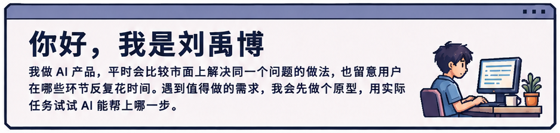
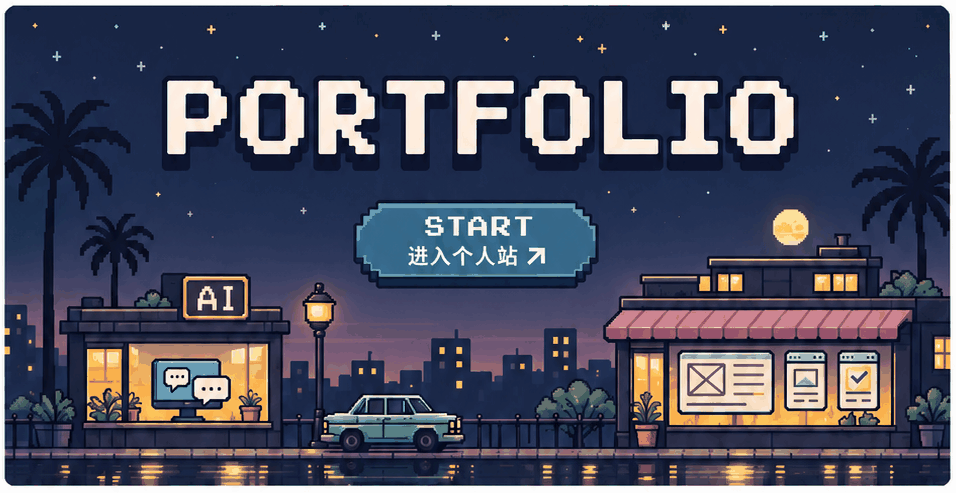
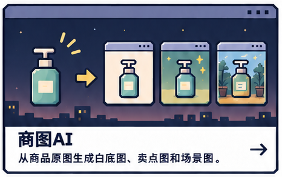
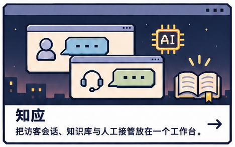
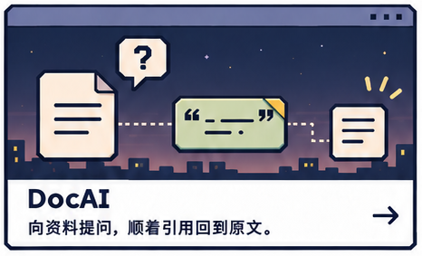
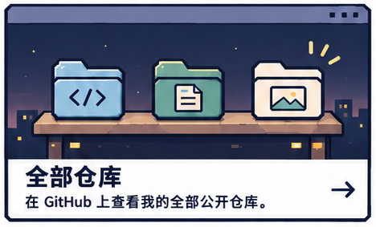

<picture>
  <source media="(max-width: 600px)" srcset="assets/night/intro-mobile.png">
  
</picture>

  <a href="https://liuyvbo2026.github.io/">
    <picture>
      <source media="(prefers-reduced-motion: reduce)" srcset="assets/night/hero.png">
      
    </picture>
  </a>

  
  

  
  

