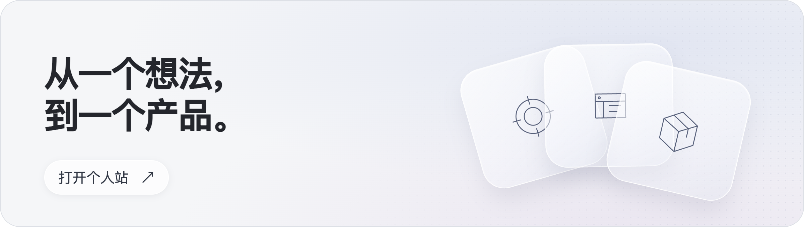

## 你好，我是刘禹博

我做 AI 产品。看一个新方向时，我先比较市面上已有的做法，再顺着用户的实际流程找出哪些环节反复花时间，哪些问题值得先解决。方案落到工作流后，我用原型和评测检验模型能接住哪些任务，在哪些地方需要人工判断。

## 作品

| 项目 | 简介 |
| :--- | :--- |
| **[商图AI ↗](https://github.com/liuyvbo2026/shangtu-ai)** | 帮电商卖家把商品原图做成一套可用于上架的白底图、卖点图和场景图。 |
| **[知应 ↗](https://github.com/liuyvbo2026/zhiying)** | 给客服团队一个处理访客会话、维护知识库和编排工作流草稿的工作台。 |
| **[DocAI ↗](https://github.com/liuyvbo2026/docai)** | 把分散的资料收进一个工作台，提问时可以回到原文核对答案。 |
