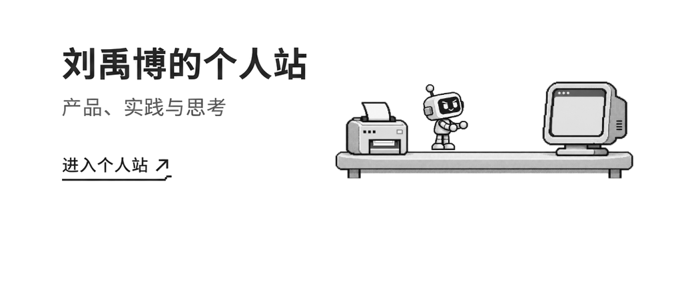
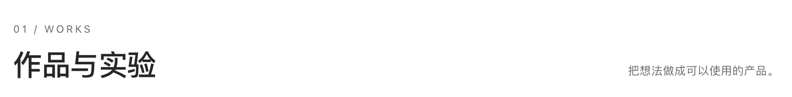
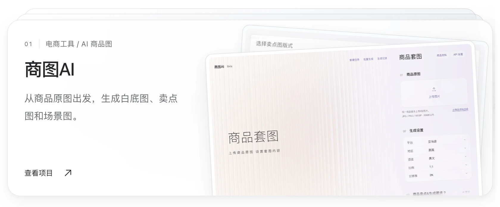
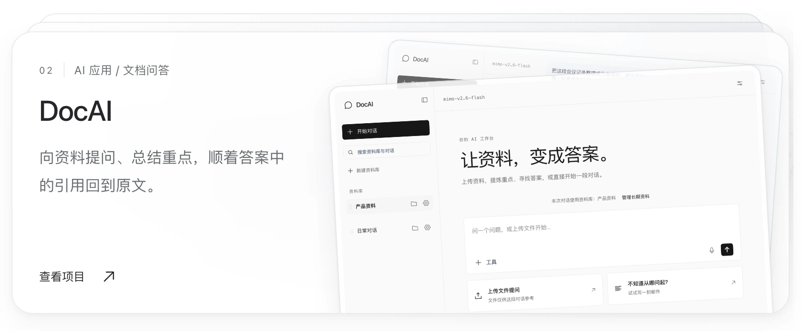
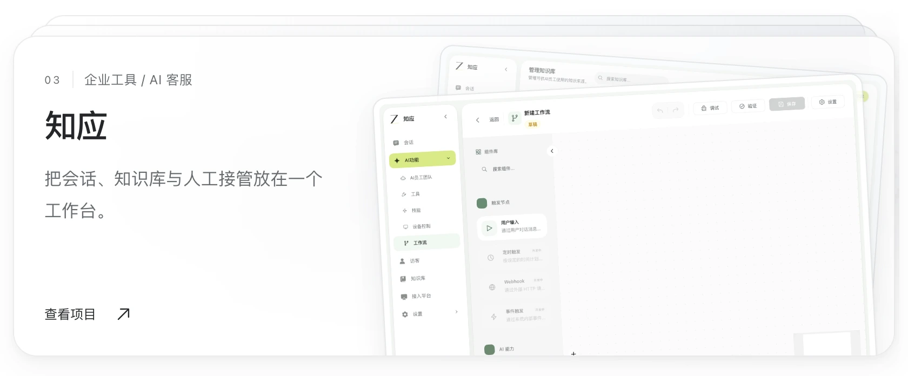
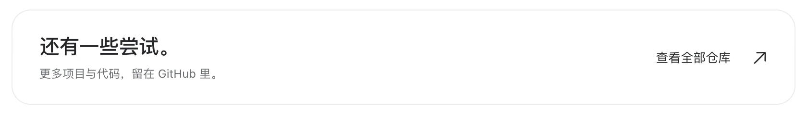

  <a href="https://liuyvbo2026.github.io/">
    <picture>
      <source media="(max-width: 600px) and (prefers-reduced-motion: reduce)" srcset="assets/airy-studio/hero-mobile.png">
      <source media="(max-width: 600px)" srcset="assets/airy-studio/hero-mobile.gif">
      <source media="(prefers-reduced-motion: reduce)" srcset="assets/airy-studio/hero.png">
      
    </picture>
  </a>

<!-- Project gallery: design/glass-works/render.html -->

  <picture>
    <source media="(max-width: 1011px) and (prefers-color-scheme: dark)" srcset="assets/glass-works/heading-mobile-dark.webp">
    <source media="(max-width: 1011px)" srcset="assets/glass-works/heading-mobile-light.webp">
    <source media="(prefers-color-scheme: dark)" srcset="assets/glass-works/heading-desktop-dark.webp">
    
  </picture>

  <a href="https://github.com/liuyvbo2026/shangtu-ai">
  <picture>
    <source media="(max-width: 1011px) and (prefers-color-scheme: dark)" srcset="assets/glass-works/shangtu-mobile-dark.webp">
    <source media="(max-width: 1011px)" srcset="assets/glass-works/shangtu-mobile-light.webp">
    <source media="(prefers-color-scheme: dark)" srcset="assets/glass-works/shangtu-desktop-dark.webp">
    
  </picture>
  </a>

  <a href="https://github.com/liuyvbo2026/docai">
  <picture>
    <source media="(max-width: 1011px) and (prefers-color-scheme: dark)" srcset="assets/glass-works/docai-mobile-dark.webp">
    <source media="(max-width: 1011px)" srcset="assets/glass-works/docai-mobile-light.webp">
    <source media="(prefers-color-scheme: dark)" srcset="assets/glass-works/docai-desktop-dark.webp">
    
  </picture>
  </a>

  <a href="https://github.com/liuyvbo2026/zhiying">
  <picture>
    <source media="(max-width: 1011px) and (prefers-color-scheme: dark)" srcset="assets/glass-works/zhiying-mobile-dark.webp">
    <source media="(max-width: 1011px)" srcset="assets/glass-works/zhiying-mobile-light.webp">
    <source media="(prefers-color-scheme: dark)" srcset="assets/glass-works/zhiying-desktop-dark.webp">
    
  </picture>
  </a>

  <a href="https://github.com/liuyvbo2026?tab=repositories">
  <picture>
    <source media="(max-width: 1011px) and (prefers-color-scheme: dark)" srcset="assets/glass-works/repositories-mobile-dark.webp">
    <source media="(max-width: 1011px)" srcset="assets/glass-works/repositories-mobile-light.webp">
    <source media="(prefers-color-scheme: dark)" srcset="assets/glass-works/repositories-desktop-dark.webp">
    
  </picture>
  </a>

