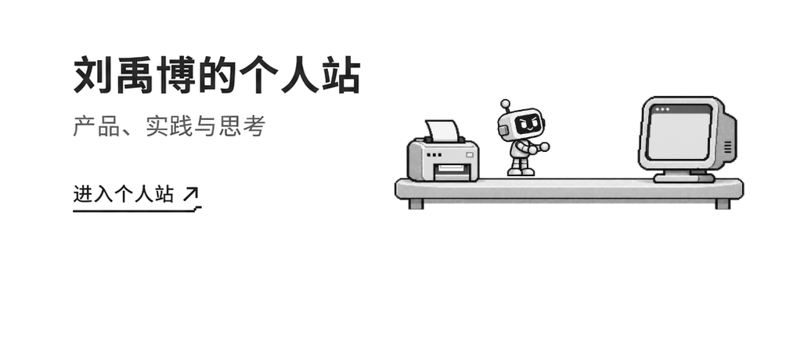
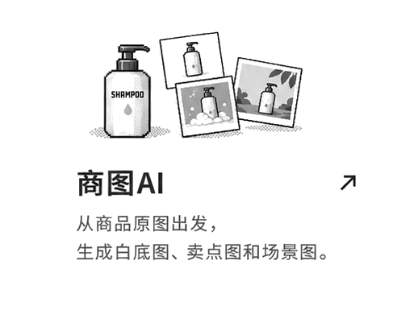
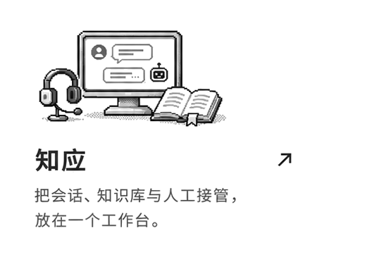
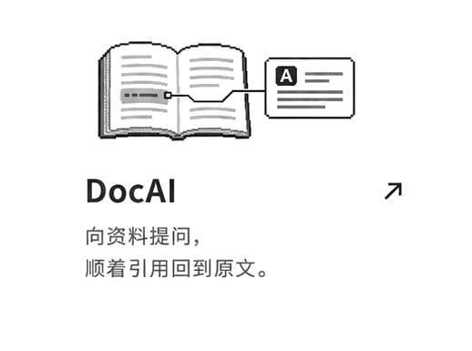
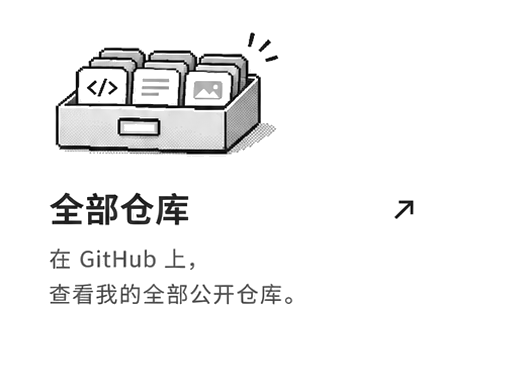

  <a href="https://liuyvbo2026.github.io/">
    <picture>
      <source media="(max-width: 600px) and (prefers-reduced-motion: reduce)" srcset="assets/airy-studio/hero-mobile.png">
      <source media="(max-width: 600px)" srcset="assets/airy-studio/hero-mobile.gif">
      <source media="(prefers-reduced-motion: reduce)" srcset="assets/airy-studio/hero.png">
      
    </picture>
  </a>

  <picture>
    <source media="(max-width: 600px)" srcset="assets/airy-studio/heading-mobile.png">
    
  </picture>

  <a href="https://github.com/liuyvbo2026/shangtu-ai"><picture><source media="(max-width: 600px)" srcset="assets/airy-studio/shangtu-mobile.png"></picture></a>
  <a href="https://github.com/liuyvbo2026/zhiying"><picture><source media="(max-width: 600px)" srcset="assets/airy-studio/zhiying-mobile.png"></picture></a>

  <a href="https://github.com/liuyvbo2026/docai"><picture><source media="(max-width: 600px)" srcset="assets/airy-studio/docai-mobile.png"></picture></a>
  <a href="https://github.com/liuyvbo2026?tab=repositories"><picture><source media="(max-width: 600px)" srcset="assets/airy-studio/repositories-mobile.png"></picture></a>

