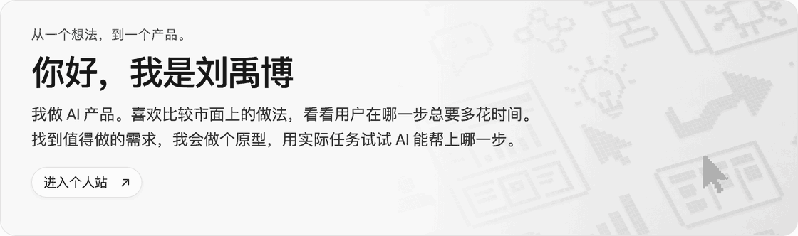
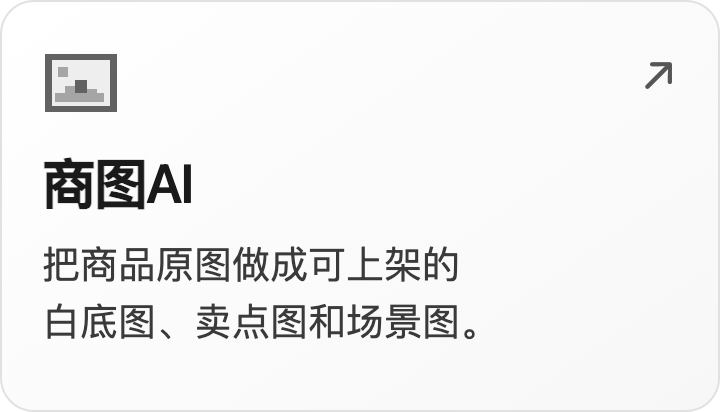
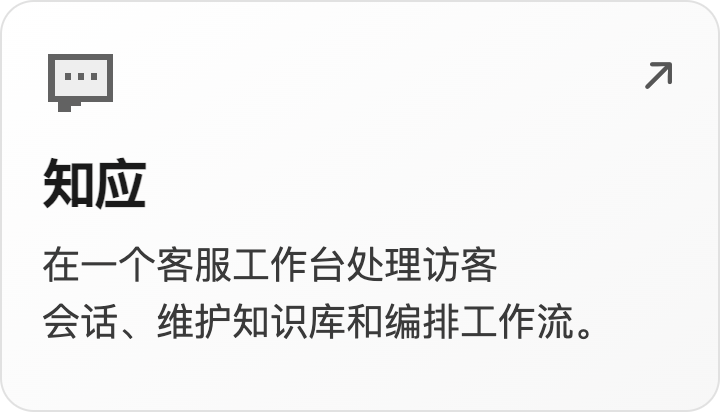
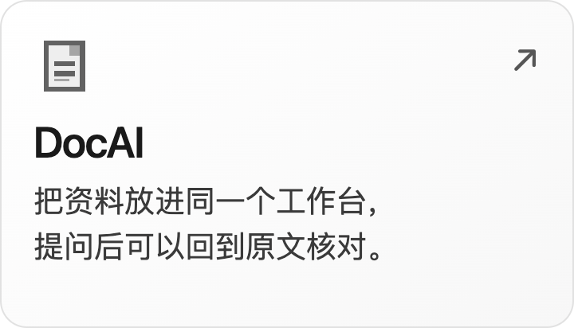

<a href="https://liuyvbo2026.github.io/">
  <picture>
    <source media="(max-width: 600px) and (prefers-reduced-motion: reduce)" srcset="assets/portfolio-mobile.png">
    <source media="(max-width: 600px)" srcset="assets/portfolio-mobile.gif">
    <source media="(prefers-reduced-motion: reduce)" srcset="assets/portfolio-hero.png">
    
  </picture>
</a>

## 精选项目

  
  
  

