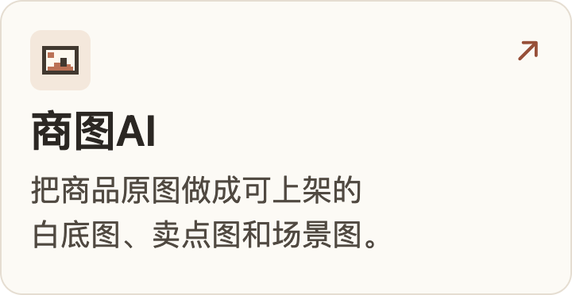
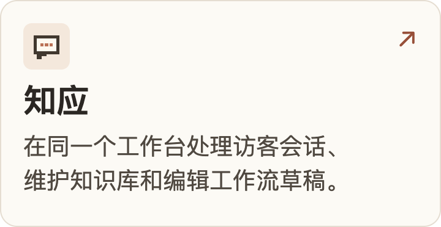
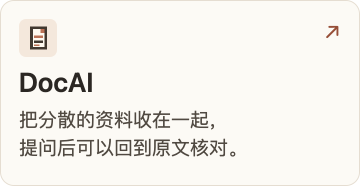

## 你好，我是刘禹博

我做 AI 产品，平时会比较市面上解决同一个问题的做法，也留意用户在哪些环节反复花时间。遇到值得做的需求，我会先做个原型，用实际任务试试 AI 能帮上哪一步。

<a href="https://liuyvbo2026.github.io/">
  <picture>
    <source media="(max-width: 600px) and (prefers-reduced-motion: reduce)" srcset="assets/doorway-mobile.png">
    <source media="(max-width: 600px)" srcset="assets/doorway-mobile.gif">
    <source media="(prefers-reduced-motion: reduce)" srcset="assets/doorway-hero.png">
    
  </picture>
</a>

## 我的项目

  
  
  

